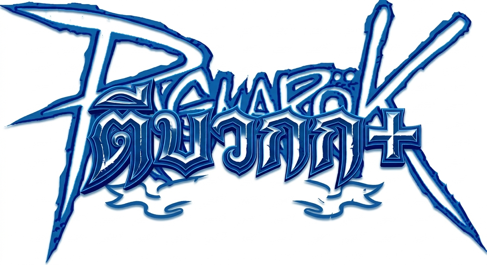

# 🔨 Ragnarok ตีบวก+ (RO Refine Online)

A browser-based refinement simulator spinoff inspired by **Ragnarok Online (Classic Pre-Renewal)**, focusing entirely on the thrill and excitement of the Morroc Blacksmith equipment upgrading system.



---

## 🌟 Key Features

- **Classic RO Refinement Mechanics (Grounded in RateMyServer)**:
  - **Weapon Level 1**: Uses *Phracon* (100% Safe to +7, 50z fee)
  - **Weapon Level 2**: Uses *Emveretarcon* (100% Safe to +6, 200z fee)
  - **Weapon Level 3**: Uses *Oridecon* (100% Safe to +5, 5,000z fee)
  - **Weapon Level 4**: Uses *Oridecon* (100% Safe to +4, 20,000z fee)
  - **Armor & Shields**: Uses *Elunium* (100% Safe to +4, 2,000z fee)
  - **Enriched Stones**: Toggle *Enriched Oridecon* / *Enriched Elunium* for significantly boosted success rates.
  - **Equipment Break Rules**: Equipment beyond safe level shatters into pieces on failure!
- **Two Refine Modes**:
  1. 🧙 **NPC Luck (Hollgrehenn)**: Based on classic RO probability tables.
  2. 🎯 **Manual Timing Minigame (Pangya Style)**: Stop the needle inside the green target zone! Needle speed increases at higher refine tiers.
- **Morroc Blacksmith Scene & Authentic UI**:
  - Morroc refinement room atmosphere with official NPC dialogue and speech cycles.
  - Classic Ragnarok sound effects (`blacksmith_refine.mp3`, level up, success, break, buying).
  - RateMyServer item database icons (70+ classic weapons and armors).
- **Bag & Inventory System**:
  - Equipment inspection tooltips showing Weapon Level, base ATK/DEF, refine bonus, required stone, and safe tier.
  - Unbox Old Blue Boxes (OBB) & Old Violet Boxes (OVB) to obtain rare equipment and gems.
  - Combine 5 Rough Oridecon / Elunium into pure stones.
- **Midgard Merchant Shop**:
  - Buy stones, low-tier weapons, high-tier weapons, and armors.
  - **Exponential Sell Scaling**: Over-refined gear (+8, +9, and +10) sells for exponentially massive Zeny rewards, giving high-risk smithing a huge payoff!
- **Monster Hunting**:
  - Send character hunting every 2 hours to earn Zeny, drop rough ores, and rare gear.
- **Trophies & Achievements**:
  - Track stats (Total refines, successes, breaks, max refine reached, boxes opened) and unlock achievement badges.
- **Fully Mobile Responsive**:
  - Designed for both desktop and mobile devices with touch-friendly controls, swipeable shop tabs, and responsive inspection modals.

---

## 🚀 How to Run Locally

No build tools or server setup required! Simply open `index.html` in any modern web browser:

```bash
# Clone the repository
git clone https://github.com/flztam/RO-.git
cd RO-

# Open in browser
xdg-open index.html   # On Linux
open index.html       # On macOS
start index.html      # On Windows
```

---

## 📜 Legal Notice & Disclaimer

เกม **RO+ Refine (Ragnarok ตีบวก+)** นี้สร้างขึ้นเพื่อความบันเทิงและการศึกษาเท่านั้น **ไม่มีวัตถุประสงค์เพื่อแสวงหาผลกำไรใด ๆ ทั้งสิ้น**

ลิขสิทธิ์ทั้งหมดของชื่อ, ตัวละคร, ไอเทม, เครื่องหมายการค้า และภาพประกอบของ **Ragnarok Online®** เป็นกรรมสิทธิ์ของ **Gravity Co., Ltd.** และ/หรือ **Lee MyoungJin (studio DTDS)** และผู้ถือสิทธิ์แฟรนไชส์แต่เพียงผู้เดียว

*All rights reserved to Gravity Co., Ltd. This is an open-source non-profit fan tribute.*
